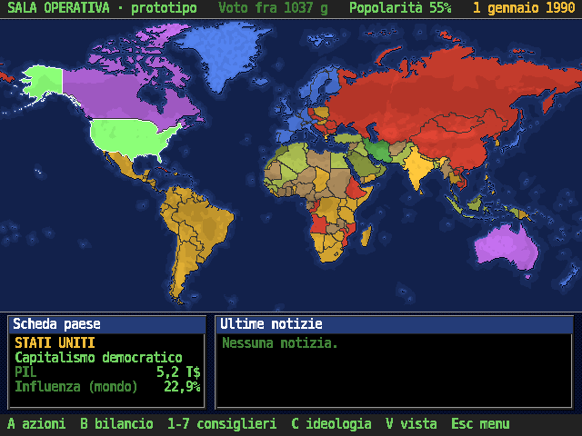

# Sala Operativa

*[Versione italiana](README.md)*

**A pixel-art geopolitical simulation, from 1990 to 2026.** You are the President of the United States, governing a world of more than two hundred countries built on real data from the CIA World Factbook: diplomacy, covert operations, wars, the federal budget, elections and nuclear crises. Each game starts from the year you choose and can stay true to history or drift toward an alternate world.

The game is in **English and Italian** and is inspired by *Shadow President* (D.C. True, 1993), whose simulation model was reconstructed through reverse engineering for study purposes. The name, graphics, sounds and texts are original, and nothing from the original game is distributed.



> Playable prototype in the browser, a 640×480, 256-color screen in the style of 1990s SVGA. Play online at https://timrouter.dns.army/sala-operativa/ (add `?lang=en` for English). License: [GPL-3.0](LICENSE).

## What's in the game

- **The real world, year by year**: all 37 editions of the CIA World Factbook, 1990–2026, including the states that disappeared (USSR, Yugoslavia, Czechoslovakia, the two Germanys, the two Yemens).
- **Generated at start-up**: what the Factbook does not say (ideology, ethics and ambition of governments, peace levels, nuclear arsenals, alliances, troops abroad) comes from rules and a seed; a "drift" setting moves history from faithful to alternate.
- **26 actions** with the success odds of the original model, from peace envoys to coups, embargoes, troop deployments and nuclear strikes.
- **A world that acts on its own**: every week AI countries pick targets and actions, answer what is done to them, and prepare covert operations the CIA may warn you about. Before an aggression time stops and you choose how to react.
- **Wars, nuclear weapons, unrest and disasters**, the federal budget, popularity, elections every four years, seven advisors and the cabinet meeting.
- **Saves stay in your browser**: one game per browser, saved every month and resumed from the start screen.

## How to play

| key | action |
|---|---|
| click on the map, ↑ ↓ | select a country |
| **A** | actions against the selected country (Enter to execute, **G** for the cabinet meeting) |
| **B** | federal budget (takes effect on January 1) |
| **1 – 7** | advisors' reports |
| **Space** / **Enter** | advance one day / one month |
| **Tab** | map or country list |
| **C** / **V** | map colors (ideology, teams, regions) / political or physical view |
| **Z**, mouse wheel | zoom the map: world, region, country (drag to move) |
| **M** / **U** | music / sound effects |
| **F5** / **F9** | save / load |
| **Esc** | back to the start menu |
| **L** (start screen) | English or Italian; also `?lang=en` or `?lang=it` in the address |

The first time, the game speaks Italian if your browser is set to Italian and English otherwise; the choice made with L is remembered, and a saved game continues in either language.

## Quick start

You need **Node.js 22** or later and **Python 3** (only to regenerate the scenarios).

```bash
git clone https://github.com/Indr1d-C0ld/Sala-Operativa.git
```

```bash
cd Sala-Operativa && npm install
```

```bash
npm run scenari
```

```bash
npm run dev
```

The game opens at http://localhost:5173. `npm run scenari` builds the starting packages for the 37 years (about 20 MB) from the Factbook database in the repository; `npm run build` produces the static version in `packages/app/dist/`; `npm test` and `npm run typecheck` check everything.

## Documentation

The project is developed in Italian: code comments and documents ([the simulation model](docs/MODELLO.md), [engine and architecture](docs/MOTORE.md), [work log](docs/STATO.md), [reverse-engineering notes](re/FORMATS.md)) are in Italian. The game texts live in `packages/app/src/testi/` (`it.json`, `en.json`, plus the country names).

## Data and credits

- **CIA World Factbook** 1990–2026 (public domain, a work of the US government), via [MilkMp/CIA-World-Factbooks-Archive-1990-2025](https://github.com/MilkMp/CIA-World-Factbooks-Archive-1990-2025) and [factbook/factbook.json](https://github.com/factbook/factbook.json).
- **Natural Earth** 1:50m country borders and the "Natural Earth I" shaded-relief raster (public domain).
- **Pixel art**: map relief and advisor portraits generated with [PixelLab](https://www.pixellab.ai/) and reduced to the game palette.
- **Sounds and music**: composed and synthesized for the project.

## Reverse engineering and rights

The simulation model was reconstructed by studying the *Shadow President* executable with Ghidra and custom tools, for study and interoperability. The repository **does not contain** the original executable, assets, texts or manual. *Shadow President* is a trademark of its respective owners; this project is neither affiliated with nor endorsed by them.

## License

Distributed under the terms of the [GNU General Public License v3.0](LICENSE) or later (GPL-3.0-or-later).
