# Sala Operativa

**Una simulazione geopolitica in pixel-art, dal 1990 al 2026.** Sei il presidente degli Stati Uniti: governi un mondo di oltre duecento paesi costruito sui dati reali del CIA World Factbook, fra diplomazia, operazioni coperte, guerre, bilancio federale, elezioni e crisi nucleari. Ogni partita parte dall'anno che scegli e può restare fedele alla storia o deviare verso un mondo alternativo.

Il gioco è **interamente in italiano** ed è ispirato a *Shadow President* (D.C. True, 1993). Di quel gioco riprende il modello di simulazione, ricostruito con il reverse engineering per studio. Nome, grafica, suoni e testi sono originali, e del gioco originale non viene distribuito nulla.

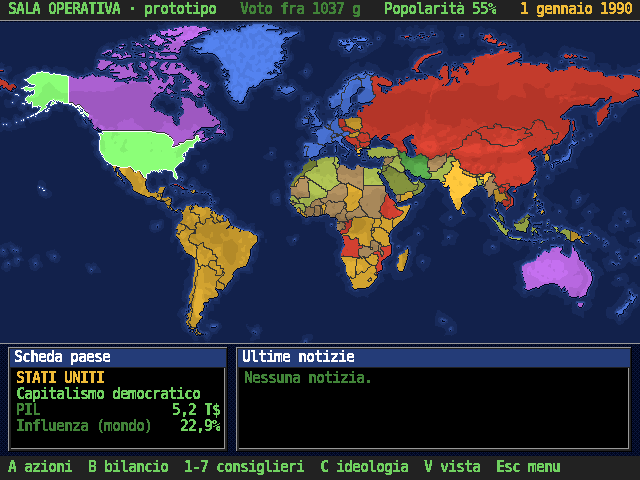

> Prototipo giocabile nel browser, schermo 640×480 a 256 colori in stile SVGA anni '90. Licenza [GPL-3.0](LICENSE).

## Immagini

| | |
|---|---|
| 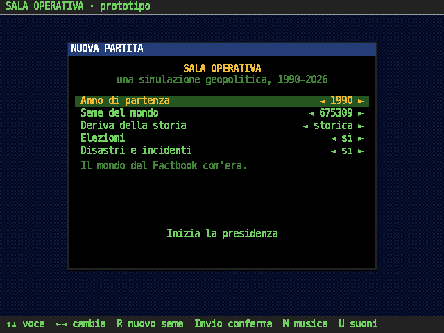 | 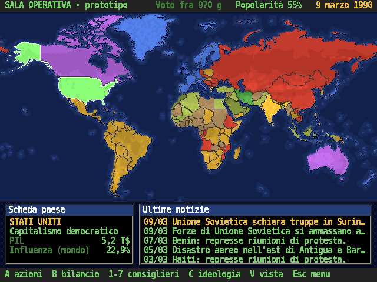 |
| **Nuova partita**: anno, seme del mondo, deriva della storia, elezioni e disastri | **La sala operativa**: carta politica per ideologia e notizie dal mondo |
| 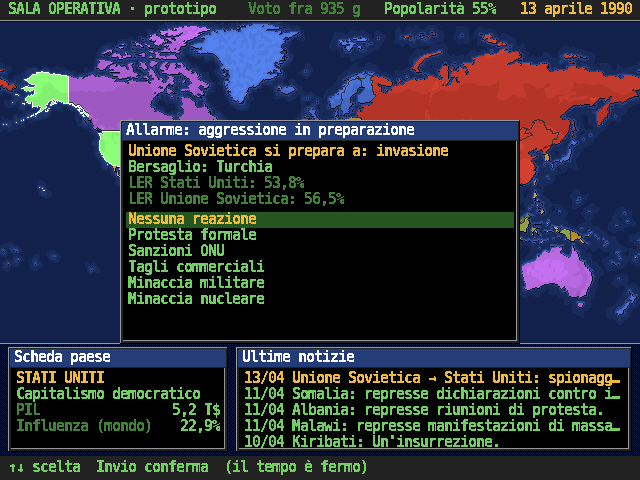 | 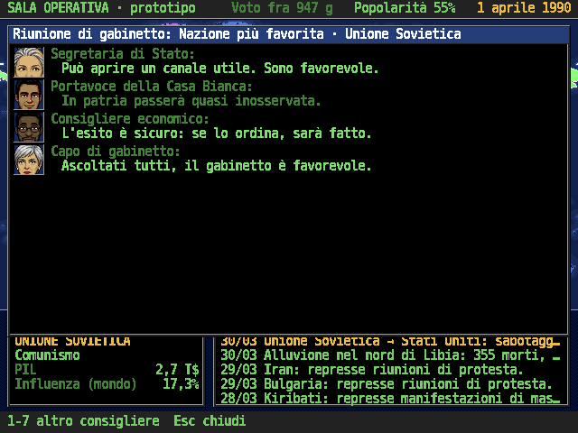 |
| **Allarme**: l'URSS si prepara a invadere la Turchia; il tempo si ferma e si sceglie la reazione | **Riunione di gabinetto**: il parere dei consiglieri sull'azione scelta |
| 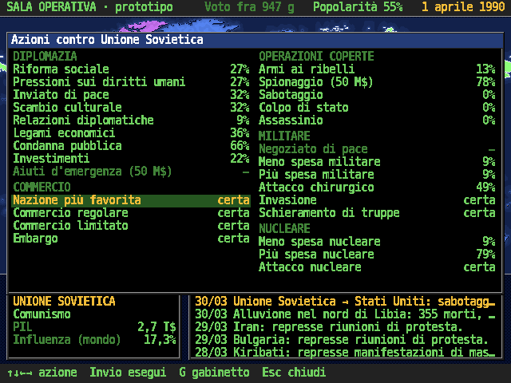 | 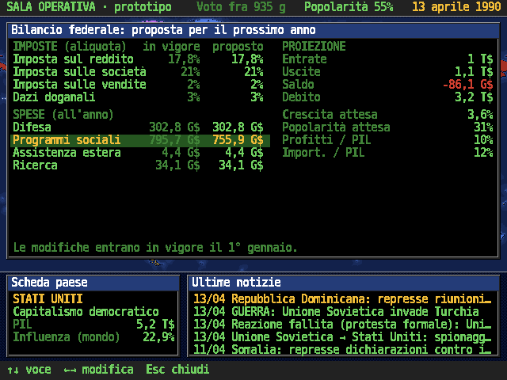 |
| **Azioni**: diplomazia, commercio, operazioni coperte, forza militare e nucleare, con le probabilità di riuscita | **Bilancio federale**: imposte e spese, con la proiezione di crescita, saldo e popolarità |
| 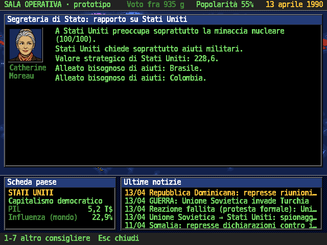 | 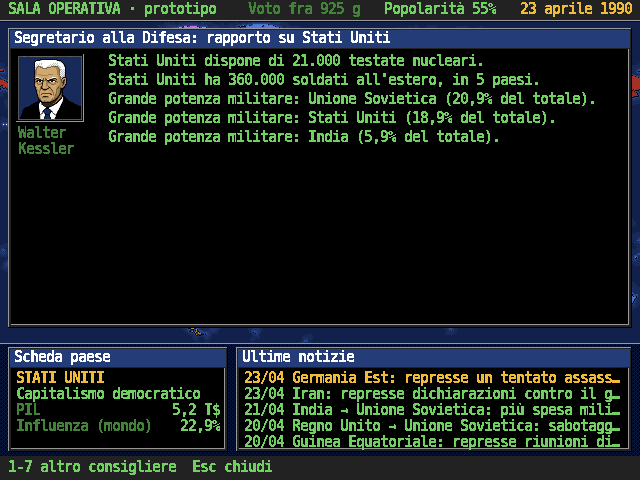 |
| **Consiglieri**: sette collaboratori, ciascuno con il suo rapporto sul paese selezionato | **Difesa**: arsenali, truppe all'estero e grandi potenze |
| 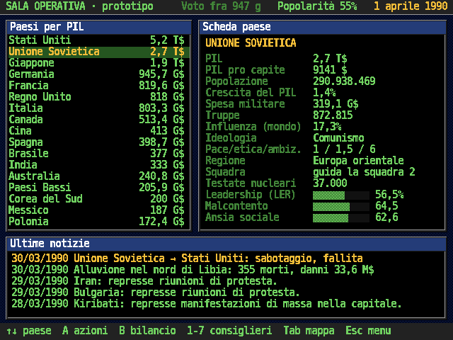 | 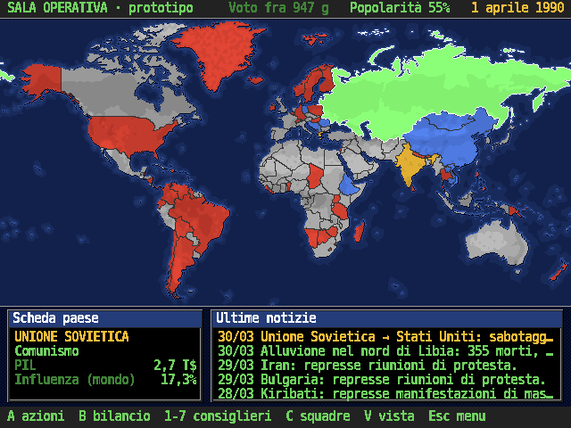 |
| **Scheda paese**: economia, forze armate, ideologia, leadership e malcontento | **Alleanze**: la carta colorata per squadre (o per regioni) |
| 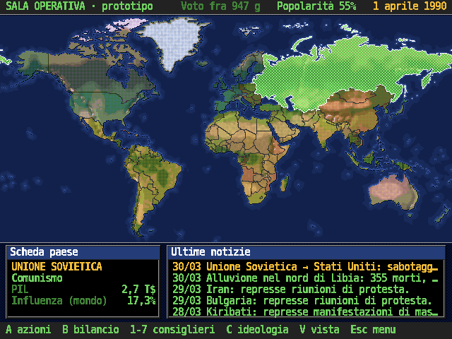 | 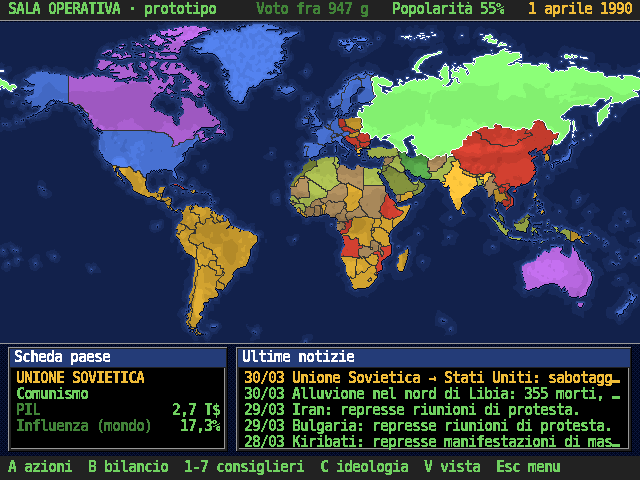 |
| **Vista fisica**: il rilievo pixel-art sotto i confini | **Il mondo del 1990**: Unione Sovietica, Jugoslavia, le due Germanie |

## Che cosa c'è nel gioco

- **Il mondo vero, anno per anno.** Tutte le 37 edizioni del CIA World Factbook, dal 1990 all'edizione finale del 2026: economia, popolazione, forze armate, governi, religioni, confini. Gli stati scomparsi (URSS, Jugoslavia, Cecoslovacchia, le due Germanie, i due Yemen) compaiono negli anni giusti.
- **Generazione all'avvio.** Quello che il Factbook non dice si genera con regole e seme: ideologia, etica e ambizione dei governi, livello di pace, arsenali nucleari, regioni, alleanze, contingenti all'estero.
- **Deriva della storia.** Da "storica" ad "alternativa": regimi che cambiano, economie ed eserciti rimescolati, nuove potenze nucleari. Lo stesso seme ricrea lo stesso mondo.
- **26 azioni** con le probabilità di successo del modello originale: dagli inviati di pace agli aiuti d'emergenza, dall'embargo al colpo di stato, dallo schieramento di truppe all'attacco nucleare.
- **Un mondo che agisce da solo.** Ogni settimana i paesi IA scelgono bersagli e azioni; prima di un'aggressione il tempo si ferma e puoi reagire con proteste, sanzioni ONU (con il veto), tagli commerciali o minacce.
- **Guerre** con potenza dei lati, perdite, civili, danni economici, resa e annessione; alleati che difendono i paesi in cui hanno truppe; escalation nucleare di chi perde.
- **Armi nucleari** con ricaduta regionale, crollo mondiale e ritorsioni.
- **Disordini sociali** in dieci stadi, dalle riunioni di protesta alla guerra civile, con cambi di regime.
- **Disastri**: carestie, terremoti, alluvioni, incidenti; quelli provocati dall'uomo hanno un colpevole, che la CIA scopre.
- **Il presidente**: bilancio federale con quattro imposte e quattro spese, popolarità, elezioni ogni quattro anni, impeachment e assassinio sotto il 15%, vittoria dopo venticinque mandati.
- **Sette consiglieri** con ritratti pixel-art e rapporti propri; la riunione di gabinetto prima di ogni decisione.
- **Mondo persistente**: salvataggio automatico ogni mese nel browser, ripresa dalla schermata iniziale.
- **Musica e suoni** originali in stile scheda audio anni '90 (sintesi FM e General MIDI).

## Come si gioca

| tasto | azione |
|---|---|
| clic sulla mappa, ↑ ↓ | scegli un paese |
| **A** | azioni contro il paese scelto (Invio per eseguire, **G** per la riunione di gabinetto) |
| **B** | bilancio federale (vale dal 1° gennaio) |
| **1 – 7** | rapporti dei consiglieri |
| **Spazio** / **Invio** | avanza di un giorno / di un mese |
| **Tab** | mappa o elenco dei paesi |
| **C** / **V** | colori della mappa (ideologia, squadre, regioni) / vista politica o fisica |
| **Z**, rotella | ingrandisci la mappa: mondo, regione, paese (trascinala per spostarti) |
| **M** / **U** | musica / effetti sonori |
| **F5** / **F9** | salva / carica la partita |
| **Esc** | torna al menu iniziale |

Quando arriva un allarme, una proposta o la resa, il tempo si ferma finché non scegli.

## Avvio rapido

Servono **Node.js 22** o successivo e **Python 3** (solo per rigenerare gli scenari).

```bash
git clone https://github.com/Indr1d-C0ld/Sala-Operativa.git
```

```bash
cd Sala-Operativa && npm install
```

```bash
npm run scenari
```

```bash
npm run dev
```

Il prototipo si apre su http://localhost:5173. `npm run scenari` genera i pacchetti di partenza dei 37 anni (circa 20 MB) dal database del Factbook incluso nel repository; `npm run build` produce la versione statica in `packages/app/dist/`.

```bash
npm test
```

```bash
npm run typecheck
```

`npm run taratura` simula molte partite senza interfaccia e riassume il comportamento dell'IA (guerre, annessioni, atomiche, pause per il giocatore); le opzioni sono in testa a `tools/taratura_ia.ts`.

## Struttura

| percorso | contenuto |
|---|---|
| `packages/core` | la simulazione, pura e deterministica: mondo, sistemi (economia, influenza, alleanze, azioni, IA, guerra, nucleare, disordini, disastri, bilancio, mandato, consiglieri), salvataggi; oltre 150 test |
| `packages/data` | le regole: profilo "classico" ricavato dall'originale e regole di generazione del mondo |
| `packages/ui` | lo schermo 640×480 a palette: framebuffer, dithering, font bitmap, finestre, carta |
| `packages/app` | il gioco nel browser: schermate, testi italiani (`src/testi/it.json`), audio, mappa, ritratti, scenari |
| `data/` | `worldbook.sqlite`: il CIA World Factbook 1990–2026 normalizzato ([data/README.md](data/README.md)) |
| `tools/` | strumenti Python: costruzione del database, esportazione degli scenari, carta, rilievo, ritratti, audio, reverse engineering |
| `docs/` | [MODELLO.md](docs/MODELLO.md) (il modello di simulazione), [MOTORE.md](docs/MOTORE.md) (motore e architettura), [STATO.md](docs/STATO.md) (diario dei lavori) |
| `re/` | [FORMATS.md](re/FORMATS.md): formati dati e formule del gioco di riferimento ricostruiti con il reverse engineering |

## Dati, fonti e crediti

- **CIA World Factbook** 1990–2026 (pubblico dominio, opera del governo USA), tramite l'archivio [MilkMp/CIA-World-Factbooks-Archive-1990-2025](https://github.com/MilkMp/CIA-World-Factbooks-Archive-1990-2025) e [factbook/factbook.json](https://github.com/factbook/factbook.json).
- **Natural Earth** 1:50m, confini degli stati e raster "Natural Earth I" con rilievo ombreggiato (pubblico dominio), per la carta politica e per il rilievo della vista ingrandita.
- **Grafica pixel-art**: rilievo della carta e ritratti dei consiglieri generati con [PixelLab](https://www.pixellab.ai/) e ridotti alla palette del gioco.
- **Suoni e musiche**: composti e sintetizzati per il progetto (`tools/build_audio.py`).
- **Contingenti militari e arsenali nucleari** di partenza: stime pubbliche arrotondate, nelle regole di generazione.

## Reverse engineering e diritti

Il modello di simulazione è stato ricostruito studiando l'eseguibile di *Shadow President* con Ghidra e strumenti propri: formati dei file, formule, tabelle e regole sono documentati in [re/FORMATS.md](re/FORMATS.md), a scopo di studio e interoperabilità. Il repository **non contiene** l'eseguibile, gli asset, i testi o il manuale del gioco originale: restano fuori dal controllo di versione, e i test che li usano si saltano da soli se mancano. *Shadow President* è un marchio dei rispettivi titolari; questo progetto non è affiliato né approvato da loro.

## Stato

Il gioco è un **prototipo giocabile** completo nei sistemi principali. Fra i passi possibili: altri paesi giocabili oltre agli Stati Uniti, più salvataggi, un'app Android. Le scelte di modello ancora provvisorie sono segnate con ◇ in [MODELLO.md](docs/MODELLO.md); il diario completo è in [STATO.md](docs/STATO.md).

## Licenza

Distribuito secondo i termini della [GNU General Public License v3.0](LICENSE) o successiva (GPL-3.0-or-later).
